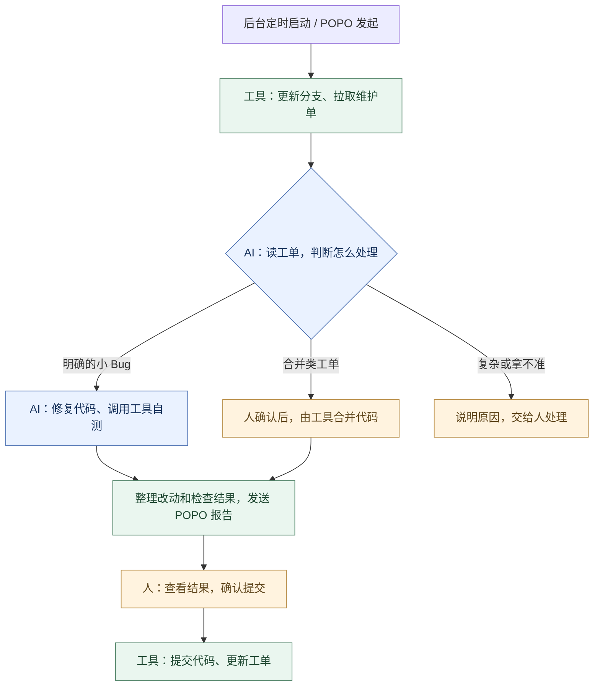
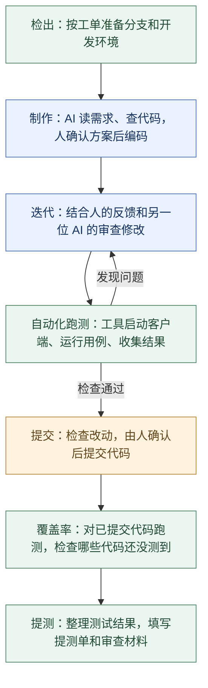

# 日常开发工具

基本的思路是agent根据skill控制流程，脚本负责具体的执行。目前常用的有以下工具：

1. pm管理流：脚本层提供pm工单的基本操作，比如筛选当前工单，获取工单内容和附件，
2. svn更新脚本：主要负责一些周维护
## 1. 维护自动化

到时间后，后台服务先更新分支，把维护单拉下来，再让 AI 看每张单适合怎么处理。明确的小问题自动修，合并单先问人，复杂的单留下原因等人接手。修复时如果发现做不下去，也会停下来说明情况。

处理结果通过 POPO 发回来，我看完再确认提交；需要调整，引用卡片回复意见，它会接着原来的任务继续做。

基本原理是：后台服务负责定时和收消息，需要干活时启动 AI 会话。AI 调用已有脚本完成查单、改码和测试，最后把结果交回来，等人确认。

## 2. 日常开发：从检出到提测

从工单开始，AI 帮忙准备分支、查代码、整理方案。方案确认后写代码，再根据反馈和独立审查继续修改。

改完后，通过游戏的调试接口操作客户端，运行测试用例，检查结果和报错，也检查这次修改的代码是否实际执行到。有问题就回去改，通过后再确认提交。

提交前的自测和后面的覆盖率分开看：前者检查当前改动能不能正常运行；后者针对已提交的代码，查看还有哪些地方没测到，按缺口补测，最后整理材料提测。跑到代码不代表逻辑一定正确，还要看用例结果。

基本原理是：把开发约定写成 AI 能读取的规则，把常用操作封装成脚本或接口。AI 根据当前任务选择下一步，再用审查和测试结果判断是否需要返工。人主要负责需求取舍、确认方案和检查最终结果。
