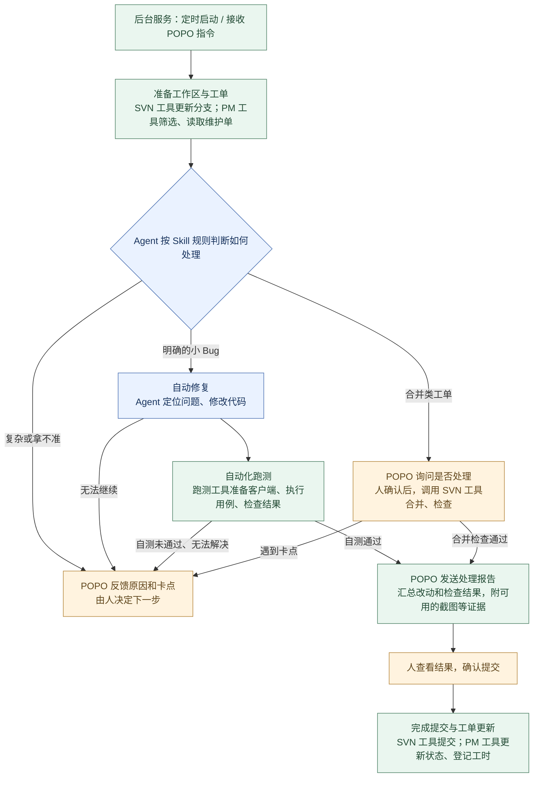
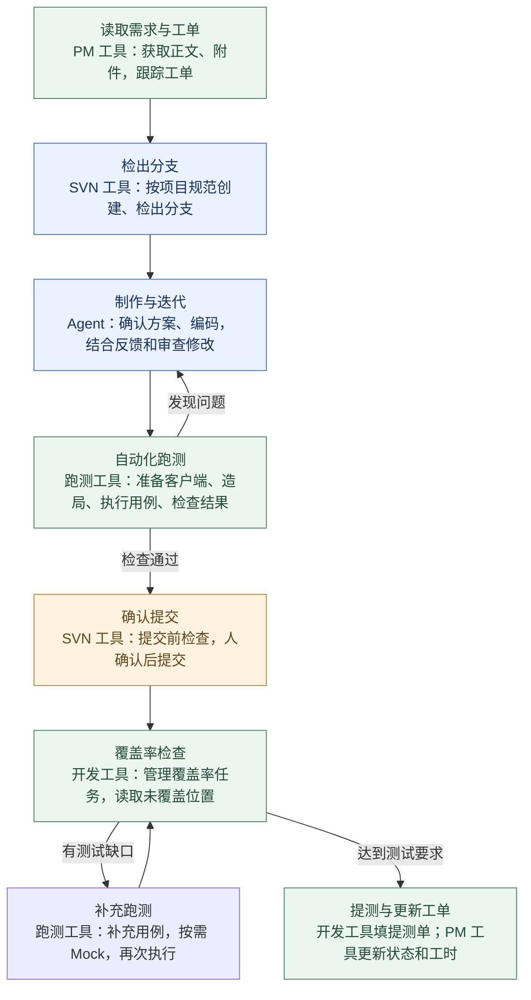

# AI 在开发和维护中的应用

今天主要分享两件事：一是让 AI 帮忙处理维护单，二是把日常开发从检出到提测的步骤串起来。两张图里的分工都一样：AI 理解需求、判断和写代码，工具执行操作，人确认关键结果。

## 1. 维护自动化

到时间后，后台服务先更新分支，把维护单拉下来，再让 AI 看每张单适合怎么处理。明确的小问题自动修，合并单通过 POPO 问人，复杂或拿不准的单也通过 POPO 反馈原因。修复中如果发现做不下去，同样停下来反馈卡点，由人决定下一步。

处理结果通过 POPO 发回来，我看完再确认提交；需要调整，引用卡片回复意见，它会接着原来的任务继续做。

基本原理是：后台服务负责定时、接收 POPO 消息和安排任务，Agent 按 Skill 的约定判断怎么处理，再调用 PM、SVN、跑测工具执行。能完成的发报告等人确认提交，复杂问题和执行中的卡点也通过 POPO 反馈。

## 2. 日常开发：从检出到提测

这条流程由 Agent 根据 Skill 的规则推进：PM 工具提供工单背景，SVN 工具管理分支和提交，跑测工具操作游戏并执行用例，开发工具负责覆盖率和提测。Skill 说明先后顺序、项目约定和检查要求，Agent 根据当前结果决定调用哪个脚本、传什么参数。

从工单开始，AI 帮忙准备分支、查代码、整理方案。方案确认后写代码，再根据反馈和独立审查继续修改。

改完后，通过游戏的调试接口操作客户端，运行测试用例，检查结果和报错，也检查这次修改的代码是否实际执行到。有问题就回去改，通过后再确认提交。

提交前的自测和后面的覆盖率分开看：前者检查当前改动能不能正常运行；后者针对已提交的代码，查看还有哪些地方没测到，按缺口补测，最后整理材料提测。跑到代码不代表逻辑一定正确，还要看用例结果。

基本原理是：把开发约定写成 AI 能读取的规则，把常用操作封装成脚本或接口。AI 根据当前任务选择下一步，再用审查和测试结果判断是否需要返工。人主要负责需求取舍、确认方案和检查最终结果。
